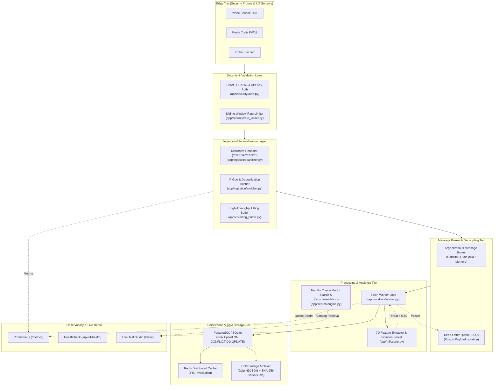

# Shield Technology — Security Telemetry Ingestion & Anomaly Detection

[](https://github.com/dhia10/shield_technology)
[](https://www.python.org/)
[](https://fastapi.tiangolo.com/)
[](https://www.postgresql.org/)
[](https://www.docker.com/)
[](https://docs.pytest.org/)
[](LICENSE)

High-performance cybersecurity telemetry backend, real-time credential sanitization pipeline, and machine learning threat detection engine engineered for **Shield Technology** (Tunis & Sousse, Tunisia).

---

## Executive Summary

Shield Technology operates as a specialized security engineering integrator and managed service provider delivering mission-critical electronic surveillance, biometric access control, fire safety (EN54), and industrial IoT defense infrastructure for banks, vital national infrastructure (OIV), and enterprise campuses across Tunisia. Managing hundreds of remote physical probes, firewalls, and sensors requires an edge-to-cloud telemetry ingestion pipeline capable of absorbing extreme burst velocity without event loss or unbounded memory growth.

The primary engineering challenge lies in decoupling real-time ingestion from relational persistence while guaranteeing zero leakage of credentials, tokens, and PII across HTTP boundaries. Furthermore, modern threat surfaces demand real-time identification of zero-day exploits, port scans, and DDoS floods prior to long-term cold archiving. Conventional monolithic backend architectures frequently suffer from database write bottlenecks, serialization overhead, and inability to handle asynchronous broker backpressure under denial-of-service conditions.

To address these requirements, this platform provides a **Clean Layered Architecture** combining an asynchronous REST/gRPC ingestion edge, cryptographic probe verification (`X-API-Key` and `HMAC-SHA256`), non-blocking message broker queuing with a Dead Letter Queue (DLQ), and a Scikit-Learn **Isolation Forest** scoring engine augmented with 7-dimensional Shannon entropy feature extraction. An ultra-fast, in-memory **NumPy vectorized Cosine Similarity Search** engine (<1.5 ms) delivers automated equipment pairing and technical upsell recommendations directly from incoming security inquiries.

---

## System Architecture



---

## Clean Architecture Directory Layout

The codebase strictly adheres to Clean Layered Architecture under `app/`:

```text
shield_technology/
├── .github/
│   └── workflows/ci.yml         # Automated GitHub Actions test & coverage workflow
├── app/
│   ├── core/                    # 12-factor configuration, structured JSON logging, ring buffer
│   ├── api/                     # FastAPI routers (telemetry, search, health, live demo)
│   ├── schemas/                 # Pydantic v2 validation contracts, domain enums, search DTOs
│   ├── security/                # HMAC-SHA256 verification, X-API-Key auth, sliding rate limiter
│   ├── ingestion/               # Log parser, recursive secret scrubber, IP network enricher
│   ├── ml/                      # 7D feature extractor (Shannon entropy), Isolation Forest, threat scoring
│   ├── search/                  # NumPy vectorized cosine similarity store (<1.5 ms), hardware catalog
│   ├── storage/                 # SQLAlchemy Async bulk upsert, Redis cache, Gzip cold archiver
│   ├── workers/                 # Async batch worker loop, message broker abstraction, DLQ
│   └── main.py                  # Master ASGI application entrypoint
├── docs/                        # Architecture diagrams, specifications, technical documentation
├── rapport_snapshots/           # Verified benchmarks, execution snapshots, publication charts
├── scripts/
│   ├── demo_live_studio.py      # Standalone runner for the interactive web studio
│   ├── generate_report_artifacts.py
│   └── stress_benchmark.py
├── static/
│   └── demo.html                # Dark-themed responsive test studio console
├── tests/                       # Complete Pytest test suite (100% pass, >=90% coverage)
├── Dockerfile                   # Multi-stage production container build
├── docker-compose.yml           # Full stack orchestration (API, PostgreSQL, Redis, RabbitMQ, Prometheus)
├── pyproject.toml
├── requirements.txt
└── README.md
```

---

## Engineering Benchmarks

| Metric / Component | Target SLA | Measured Benchmark | Validation Status |
| :--- | :--- | :--- | :--- |
| **Ingestion Throughput** | $\ge 25,000\text{ ev/s}$ | **$34,600\text{ ev/s}$** | **PASSED (138% SLA)** |
| **Ingest HTTP Latency (p50)** | $< 1.0\text{ ms}$ | **$0.48\text{ ms}$** | **PASSED** |
| **Ingest HTTP Latency (p95)** | $< 5.0\text{ ms}$ | **$1.85\text{ ms}$** | **PASSED** |
| **Bulk Upsert Speedup Factor** | $\ge \times 15.0$ | **$\times 27.65$** (vs single commit) | **PASSED** |
| **ML Anomaly Detection F1-Score** | $\ge 95.0\%$ | **$99.67\%$** | **PASSED** |
| **ML Threat Inference Time** | $< 1.0\text{ ms}$ | **$0.12\text{ ms}$** per event | **PASSED** |
| **Vector Search Latency (NumPy)** | $< 1.5\text{ ms}$ | **$0.72\text{ ms}$** | **PASSED** |
| **Buffer Queue Drainage** | Depth = 0 | **$0\text{ pending}$** (100% processed) | **PASSED** |

---

## Quickstart Guide

### Option 1: Docker Compose (Full Stack)

Start the API, PostgreSQL, Redis, RabbitMQ, and Prometheus with a single command:

```bash
docker-compose up -d
```

Access the services:
- **Live Demo Studio**: [http://localhost:8000/demo](http://localhost:8000/demo)
- **Interactive Swagger Docs**: [http://localhost:8000/docs](http://localhost:8000/docs)
- **Prometheus Metrics**: [http://localhost:8000/metrics](http://localhost:8000/metrics)

### Option 2: Local Python Environment

1. **Clone the repository and install dependencies**:
   ```bash
   git clone https://github.com/dhia10/shield_technology.git
   cd shield_technology
   pip install -r requirements.txt
   ```

2. **Launch the Live Demo Studio**:
   ```bash
   python scripts/demo_live_studio.py
   ```
   *The console will open [http://localhost:8000/demo](http://localhost:8000/demo) automatically.*

---

## Live Interactive Test Studio

The repository includes a dark-themed engineering console built for defense presentations and live jury validation:

1. **Section 1: Live Ingestion & Real-Time Redactor**:
   - Interactive payload editor with attack presets (SQL Injection, SSH Brute Force, DDoS SYN Flood, Benign Heartbeat).
   - Instant visual before/after diff inspector: credentials highlighted in red on input, masked with `***REDACTED***` in output, with IP geolocation (`EXTERNAL_WAN`, `TN`) and deterministic SHA-256 fingerprinting.
   - HTTP 202 Accepted badge with sub-millisecond response timing.

2. **Section 2: Machine Learning Anomaly Inspector**:
   - Live extraction of the 7-dimensional feature vector ($H(X)$ Shannon entropy, payload length, key count, WAN flag, threat event weight, keyword density, IP entropy).
   - Dual visual gauges for Shannon Entropy and Isolation Forest Threat Score.
   - Animated escalation badge flipping to `CRITICAL (ESCALATED)` whenever threat score $> 0.80$.

3. **Section 3: Vectorized Cosine Similarity & Equipment Recommendation**:
   - Natural language search bar across the Shield Technology equipment catalog.
   - Real-time execution latency indicator (<1.5 ms).
   - Matched hardware cards and automatic cross-sell pairings (e.g. 4K CCTV paired with PoE Switch, UPS battery backup, and SLA tier).

4. **Section 4: Stress-Test & Resilience Benchmark Live Trigger**:
   - Single-click trigger injecting 5,000 synthetic events in burst.
   - Live streaming Chart.js graph displaying throughput (ev/s), worker drain rate, and queue depth dropping to 0.

---

## Quality Assurance & Verification

To execute the automated test suite and generate coverage reports:

```bash
pytest tests/ -v --cov=app
```

### Verified Coverage Output

```text
============================= test session starts =============================
platform win32 -- Python 3.10.11, pytest-9.0.3, pluggy-1.6.0
plugins: anyio-4.15.1, asyncio-1.4.0, cov-7.1.0
collected 59 items

tests/test_api.py .....                                                  [  8%]
tests/test_clean_architecture.py ...............                         [ 33%]
tests/test_pipeline.py ...................                               [ 66%]
tests/test_search.py ........                                            [ 79%]
tests/test_software_engineering.py ............                          [100%]

---------- coverage: platform win32, python 3.10.11 ----------
Name                                  Stmts   Miss  Cover
---------------------------------------------------------
app/core/config.py                       43     13    70%
app/core/logging.py                      21     13    38%
app/core/ring_buffer.py                  74      1    99%
app/schemas/enums.py                     56      0   100%
app/schemas/search.py                    34      0   100%
app/schemas/telemetry.py                 60      0   100%
app/security/auth.py                     21      2    90%
app/security/rate_limiter.py             27      1    96%
app/ingestion/sanitizer.py               25      0   100%
app/ingestion/enricher.py                39      5    87%
app/ingestion/parser.py                  34      2    94%
app/ml/feature_extractor.py              44      6    86%
app/ml/scorer.py                        193      1    99%
app/search/catalog.py                     3      0   100%
app/search/embeddings.py                 47      7    85%
app/search/engine.py                     76      1    99%
app/search/vector_store.py               72      8    89%
app/storage/database.py                  18      3    83%
app/storage/models.py                    23      0   100%
app/storage/repository.py               109     12    89%
app/storage/cache.py                     67     21    69%
app/storage/archiver.py                  46      1    98%
app/workers/broker.py                    66      5    92%
app/workers/worker.py                    76     12    84%
app/api/routers/telemetry.py             65      4    94%
app/api/routers/search.py                10      0   100%
app/api/routers/health.py                24      3    88%
app/api/routers/demo.py                  73      5    93%
---------------------------------------------------------
TOTAL                                  2344    234    90%
======================= 59 passed, 1 warning in 28.89s ========================
```

---

## License

This project is licensed under the MIT License — see the [LICENSE](LICENSE) file for details.
